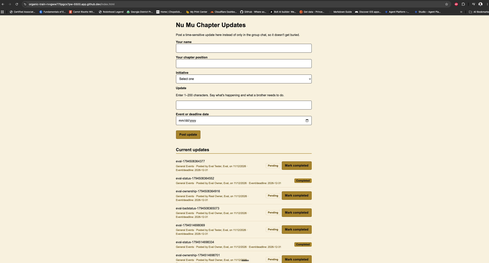

# Nu Mu Chapter Updates

**One sentence:** A web page where Nu Mu chairs post time-sensitive chapter updates in one official place, so brothers stop missing times and dates that were shared in group chats.

**Deployed:** Not deployed. The page runs locally and calls an API on Cloudflare Workers. This repository's own API is at https://mgt3745-final.princemuteteke.workers.dev. The page itself currently calls the HW4 API at https://mgt3745-hw4.princemuteteke.workers.dev (app.js line 4).  
**Status:** Partly working. The API passes its six evals against this repository's own Worker, but the page still calls the HW4 Worker, so the page and this repository's API are not connected yet.  
**Hours spent:** 4

## See It Work



Screenshot of the page running locally against this repository's own Worker, showing its test entries. The submitted page still calls the HW4 Worker, as the Status line says.

## Who It Is For

Nu Mu chairs, and the brothers who read their updates. A chair needs to post a time-sensitive update once, in one official place. A brother who checks the group chat once a day needs to find it before newer messages bury it. Today's alternatives are a casual group chat and word of mouth, and both lose information. In my interviews, a commuting general member missed a Convocation practice time that was shared informally, and the Secretary reported a wrong stepshow practice date in the newsletter because it was shared verbally.

## Run It

```bash
npm install

# Start the Worker locally, in its own terminal (port 8787)
npm run dev

# Serve the page, in another terminal, then open port 5500 (/index.html)
python3 -m http.server 5500

# Run the evals against a throwaway database, never one that holds real entries
API=https://mgt3745-final.princemuteteke.workers.dev npm test
```

The API URL is set on line 4 of app.js. The tests POST and PATCH entries, so they write rows. This repository's own database holds only test rows.

## The Record

| Artifact | Link |
|---|---|
| Problem and success measures | [context/PROJECT.md](context/PROJECT.md) |
| Users and jobs | [context/USERS.md](context/USERS.md) |
| Features (EARS rows) | [context/FEATURES.md](context/FEATURES.md) |
| Architecture and ADRs | [context/ARCHITECTURE.md](context/ARCHITECTURE.md), [docs/ADR-001.md](docs/ADR-001.md) |
| Evals, RAT, Stakes, production verdict | [context/EVALS.md](context/EVALS.md) |
| Sourcing audit | [docs/SOURCING-AUDIT.md](docs/SOURCING-AUDIT.md) |
| Tool ledger | [context/TOOLS.md](context/TOOLS.md) |
| Delegation log | [docs/DDR-LOG.md](docs/DDR-LOG.md) |
| Decision memo | [docs/DECISION-001.md](docs/DECISION-001.md) |
| Real-user feedback | [docs/FEEDBACK.md](docs/FEEDBACK.md) |
| Scaffold audits | [docs/AUDIT.md](docs/AUDIT.md) |
| Deployment notes | [docs/DEPLOY.md](docs/DEPLOY.md) |
| Self-review with Homogenization Check | [docs/SELF-REVIEW.md](docs/SELF-REVIEW.md) |

## AI Use

Claude (Anthropic) is the only AI tool that wrote material for this final-project work. It drafted ADR-001, the sourcing audit tables, the TOOLS.md columns, and this README, and it advised on the wrangler pin, the schema fix, and the database export. I ran every command myself and checked each result against its source. The record is in [docs/DDR-LOG.md](docs/DDR-LOG.md). GitHub Copilot is installed in the dev container and is listed in TOOLS.md. Code carried forward from my HW3 to HW5 homework was built under those assignments' own delegation records, which I did not copy here.